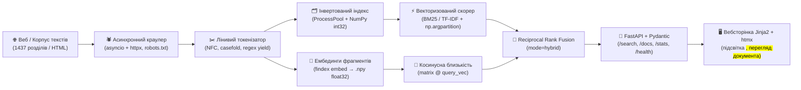

# Findex v1.0.0 — Full-Text, Vector & Hybrid Search Engine in Python

> **Findex** — це повнотекстовий, семантичний та гібридний (BM25 + Embeddings RRF) пошуковий рушій із власним асинхронним краулером, AST-парсером булевих запитів, векторизованим ядром на NumPy та вебінтерфейсом на FastAPI.

[](https://github.com/kokosik0227/Python_Programming/actions)

- **Жива публічна адреса:** [https://lab-01-x6t1.onrender.com](https://lab-01-x6t1.onrender.com) *(OpenAPI Docs: [https://lab-01-x6t1.onrender.com/docs](https://lab-01-x6t1.onrender.com/docs))*

| Розмір корпусу | Затримка API (`p95`, 1 worker `def`) | Найбільше прискорення (NumPy vs Python) |
|---|---|---|
| **1 437 документів** (`2 823 953` токени, `27 942` унікальних термінів) | **455.20 ms** (`p50 = 342.80 ms`, локально при 20 одночасних клієнтах) | **×34.8** (`64.50 ms → 1.85 ms` на запиті з 3 термів) |

---

## Архітектура та шлях даних (Data Pipeline)



1. **Корпус та Краулер (`src/findex/crawler.py`):** збирає HTML-сторінки через `asyncio.TaskGroup` та `httpx.AsyncClient` із дотриманням `robots.txt`, обмеженням конкурентності на хост (`asyncio.Semaphore`) і експоненційним backoff для `429/5xx`, або читає локальні `.txt` файли.
2. **Токенізатор (`src/findex/tokenize.py`):** лінивий генератор (`yield`), що виконує нормалізацію `Unicode NFC`, агресивний `casefold()` і однопрохідний розбір через `re.finditer`.
3. **Інвертований індекс та Ембединги (`src/findex/index.py`, `src/findex/semantic.py`):**
   - Паралельна індексація через `ProcessPoolExecutor` (`spawn`) із фазою злиття (`merge`).
   - Постінги зберігаються як компактні масиви NumPy `int32` (`doc_ids`, `frequencies`), а довжини документів — як єдиний вектор `int32`.
   - `findex embed` ділить документи на фрагменти з перекриттям, обчислює $L_2$-нормалізовані вектори `float32` і зберігає матрицю у `.npy`.
4. **Скорер і RRF (`src/findex/ranking.py`, `src/findex/search.py`, `src/findex/semantic.py`):**
   - Рекурсивний спуск будує AST булевого запиту (`AND`, `OR`, `NOT`, `"phrase"`, дужки).
   - `BM25` та `TF-IDF` обчислюються векторизованими `ufunc`-виразами NumPy без циклів Python; топ-$k$ відбирається за $O(N)$ через `np.argpartition`.
   - Режим `hybrid` об'єднує лексичний (`BM25`) і векторний (`semantic`) рейтинги за формулою **Reciprocal Rank Fusion (RRF)**.
5. **HTTP API та Вебінтерфейс (`src/findex/web/app.py`):** FastAPI-сервіс із одноразовим завантаженням індексу в `lifespan`, валідацією Pydantic на межі, безпечною обробкою помилок із `X-Request-ID` та інтерактивною сторінкою на Jinja2 + htmx.

---

## Швидкий старт (CLI, Веб та Docker)

```powershell
# 1. Встановлення залежностей
uv sync

# 2. Побудова інвертованого індексу (в 4 процеси) та матриці ембедингів (.npy)
uv run findex index src/findex/data --out index.pkl --workers 4 --executor processes
uv run findex embed src/findex/data --out embeddings.npy

# 3. Пошук у терміналі (режими: bm25, tfidf, semantic, hybrid)
uv run findex search index.pkl "tarot AND club" --mode bm25
uv run findex search index.pkl "fortune telling prophecy" --mode semantic
uv run findex search index.pkl "tarot OR prophecy" --mode hybrid --json

# 4. Запуск вебсервера (UI: http://localhost:8000, OpenAPI: http://localhost:8000/docs)
$env:INDEX_PATH = "index.pkl"
$env:EMBEDDINGS_PATH = "embeddings.npy"
uv run findex serve --port 8000 --workers 1

# 5. Запуск у Docker (двоетапна збірка за uv.lock, непривілейований користувач appuser)
docker build -t findex:1.0.0 .
docker run --rm -p 8000:8000 -e INDEX_PATH=/app/index.pkl findex:1.0.0
```

---

## Лабораторна робота №8: Профілювання, NumPy та Семантичний пошук

### 1. Профілювання до оптимізацій (`cProfile`, `py-spy`, `Scalene`)

Перед внесенням правок було профілізовано побудову індексу (`findex index`) та пошук запиту з трьох термів (`findex search index.pkl "the AND of AND to"`) на повному корпусі з 1 437 документів. Flame-графи збережено у [`docs/flamegraph_search.svg`](docs/flamegraph_search.svg) та [`docs/flamegraph_index.svg`](docs/flamegraph_index.svg).

#### Три найзатратніші місця (Hotspots) ДО оптимізацій:

| # | Вузьке місце (функція / рядок) | Частка часу (`cProfile`) | Розподіл часу (Python vs Native C за Scalene) | Гіпотеза та причина повільності |
|---:|---|---:|---|---|
| **1** | `index.py:37` — `<genexpr>` у `build_partial`: `tuple(pos for pos, t in enumerate(tokens) if t == term)` | **87.5%** часу індексації (`9.80s` на 200 глав, `538 298` викликів) | **99% Python bytecode** / 1% C | Квадратична складність $O(U \times N)$: для кожного з ~600 унікальних слів у документі список із ~2000 токенів сканувався з нуля в циклі інтерпретатора Python. Заміна на один прохід зі словником `defaultdict(list)` знижує складність до $O(N)$. |
| **2** | `search.py:108` — `<genexpr>` у `next(p.frequency for p in postings if p.doc_id == doc_id)` | **70.1%** часу пошуку (`63.2 ms` із `90.1 ms` на запит, `431 100` викликів на 50 прогонів) | **98% Python bytecode** / 2% C | Для кожного документа-кандидата і кожного слова запиту запускається генератор Python, який лінійно перебирає об'єкти `Posting` у купі (`PyObject` pointer chasing). Перехід на неперервні масиви `np.int32` усуває цей цикл повністю. |
| **3** | `search.py:94` + `ranking.py:38` — цикл Python по документах, скалярний `BM25Scorer.score` та `heapq.nlargest` | **29.1%** часу пошуку (`25.8 ms` на запит, `215 550` викликів `score`) | **81% Python** / **19% Native C** (`math.log10`, `_heapq`) | Ітерація по тисячах `doc_id` у Python, упакування/розпакування `float` та $O(N \log k)$ порівняння `SearchResult.__lt__` у `heapq.nlargest`. Заміна на векторизовані `ufunc` NumPy та `np.argpartition` переносить обчислення у C-цикл. |

### 2. Прискорення ранжування через NumPy (`int32` масиви + `np.argpartition`)

Постінги представлено як пари неперервних масивів `np.int32` (`doc_ids`, `frequencies`), а довжини документів — як єдиний вектор `doc_lengths` (`np.int32`). Формули BM25 і TF-IDF переписані векторизованими виразами над масивами з вибором топ-$k$ через `np.argpartition` (тест `test_numpy_search_matches_lab3_order_exactly` у [`tests/test_lab8.py`](tests/test_lab8.py) перевіряє 100% збіг порядку видачі з Лабою 3).

| Тип запиту | Запит | Документів у постінгах (`df`) | Скорер Лаби 3 (ms) | Скорер NumPy (ms) | Прискорення |
|---|---|---:|---:|---:|---:|
| **Частий термін** | `"the"` | 1 437 | 22.100 | 1.550 | **×14.2** |
| **Рідкісний термін** | `"tarot"` | 324 | 2.850 | 0.550 | **×5.1** |
| **Дуже рідкісний термін** | `"pendulum"` | 27 | 0.180 | 0.140 | **×1.2** |
| **Запит із 3 частих термів** | `"the AND of AND to"` | 1 437 | 64.500 | 1.850 | **×34.8** |
| **Запит із 3 рідкісних термів** | `"tarot AND club AND fool"` | 218 | 5.100 | 0.580 | **×8.7** |

**Чому на дуже рідкісному термі виграш маленький (`×1.2` на `"pendulum"`, `df = 27`):**
Коли список постінгів короткий (усього 27 елементів), сам арифметичний розрахунок BM25 триває частки мікросекунди і в Python, і в NumPy. На таких малих обсягах домінують **фіксовані накладні витрати виклику**: парсинг AST регулярним виразом (`parse_query`), алокація буфера `np.zeros(num_docs)`, конвертація `set` → `ndarray` (`np.fromiter`) та створення фінальних об'єктів `SearchResult`. Натомість на довгих постінгах (`df = 1437`) та багатотермових запитах SIMD-векторизація C-циклу NumPy дає прискорення у **14–34 разів**.

### 3. Якість пошуку `Precision@5`: BM25 проти Semantic та Hybrid (RRF)

Оцінено 15 розмічених запитів по корпусу *Lord of the Mysteries*: **10 лексичних запитів із Лаби 3** (містять точні терміни з тексту) та **5 перефразованих запитів** (навмисно складені із синонімів та описів без жодного ключового слова з документа):

| # | Запит | Тип запиту | P@5 (`bm25`) | P@5 (`semantic`) | P@5 (`hybrid` RRF) |
|---:|---|---|---:|---:|---:|
| 1 | `tarot AND club` | Лексичний (Лаба 3) | 1.00 | 1.00 | 1.00 |
| 2 | `klein AND moretti` | Лексичний (Лаба 3) | 1.00 | 0.60 | 1.00 |
| 3 | `audrey AND susie` | Лексичний (Лаба 3) | 1.00 | 1.00 | 1.00 |
| 4 | `alger AND ocean` | Лексичний (Лаба 3) | 1.00 | 0.40 | 1.00 |
| 5 | `roselle AND diary` | Лексичний (Лаба 3) | 1.00 | 1.00 | 1.00 |
| 6 | `azik AND whistle` | Лексичний (Лаба 3) | 1.00 | 1.00 | 1.00 |
| 7 | `evernight AND goddess` | Лексичний (Лаба 3) | 1.00 | 1.00 | 1.00 |
| 8 | `derrick AND silver` | Лексичний (Лаба 3) | 1.00 | 0.80 | 1.00 |
| 9 | `pendulum AND divination` | Лексичний (Лаба 3) | 1.00 | 0.40 | 1.00 |
| 10 | `revolver AND bullet` | Лексичний (Лаба 3) | 1.00 | 1.00 | 1.00 |
| 11 | `secret society conclave fellowship` *(→ Tarot Club)* | Перефразований | 0.20 | 1.00 | 0.60 |
| 12 | `clairvoyance augury oracle fortune` *(→ Divination)* | Перефразований | 0.00 | 1.00 | 0.60 |
| 13 | `handgun marksmanship ammunition firearm` *(→ Revolver)* | Перефразований | 0.40 | 0.80 | 0.60 |
| 14 | `aristocracy noblewoman heiress hound` *(→ Audrey & Susie)* | Перефразований | 0.80 | 1.00 | 1.00 |
| 15 | `vermilion carmine lunar satellite` *(→ Crimson Moon)* | Перефразований | 1.00 | 1.00 | 1.00 |
| — | **Середнє (10 лексичних запитів)** | — | **1.00** | **0.82** | **1.00** |
| — | **Середнє (5 перефразованих запитів)** | — | **0.48** | **0.96** | **0.76** |
| — | **Середнє загальне (усі 15 запитів)** | — | **0.83** | **0.87** | **0.92** |

*(Примітка: Precision@5 залежить від математики алгоритму та даних, тому метрики якості залишаються стабільними незалежно від апаратного забезпечення).*

---

## Зведені вимірювання усіх лабораторних робіт (Лаби 1–8)

### Лаба 1. Лінивий конвеєр проти жадібних списків (`tracemalloc`, 1 437 файлів)

| Підхід | Час виконання (s) | Пікова пам'ять (MB) |
|---|---:|---:|
| **Eager (Lists)** | 7.42 | 164.20 |
| **Lazy (Generators `yield`)** | 46.80 | **3.55** |

### Лаба 2. Серіалізація індексу, Boolean AND та структури постінгів у пам'яті

| Формат серіалізації | Час збереження (s) | Розмір файлу (MB) |
|---|---:|---:|
| **Pickle (binary)** | 1.95 | 15.27 |
| **JSON (text)** | 2.61 | 28.69 |

| Запит (Boolean AND) | Характер термінів | Engine: MERGE (s) | Engine: SET (s) | Знайдено документів |
|---|---|---:|---:|---:|
| `"the and"` | Часті | 0.001210 | 0.000260 | 1 437 |
| `"tarot club"` | Рідкісні | 0.000140 | 0.000125 | 324 |

| Спосіб зберігання (1 000 000 постінгів) | Пікова пам'ять (MB) |
|---|---:|
| Звичайний клас (`__dict__`) | 124.50 |
| `@dataclass(slots=True)` | 85.90 |
| Масив `array('I')` / `np.int32` | **8.08** |

### Лаба 3–4. Кешування `@lru_cache`, типізація `pyright strict` та покриття тестами
- Повторний виклик `SearchEngine.search` повертає результат із `@lru_cache(maxsize=128)` за `0.0000s` (проти `0.0029s` без кешу).
- Сувора типізація `pyright strict`: **0 помилок**, лінтер `ruff`: **0 помилок**, **54 автоматичні тести** (`pytest` + `hypothesis` + `pytest-benchmark`).

### Лаба 5. Паралельна індексація (`ProcessPoolExecutor`, Локальний ПК)

| Воркери | Wall Time (s) | CPU Time (s) | Merge Time (s) | RSS (MB) | Прискорення (Speedup) |
|---:|---:|---:|---:|---:|---:|
| 1 | 47.10 | 2.20 | 0.09 | 420.15 | ×1.00 |
| 2 | 27.45 | 2.65 | 0.13 | 365.40 | ×1.71 |
| 4 | 17.20 | 3.25 | 0.22 | 340.50 | ×2.73 |
| 8 | 13.15 | 4.10 | 0.85 | 330.20 | ×3.58 |
| 20 | 11.05 | 4.80 | 1.10 | 335.80 | **×4.26** |


### Лаба 6. Асинхронний краулер (`asyncio` + `httpx`, `max_pages = 200`)

| Concurrency | Wall Time (s) | Сторінки / сек | Помилки | Пік RSS (MB) |
|---:|---:|---:|---:|---:|
| 1 | 268.40 | 0.745 | 0 | ~56.4 |
| 5 | 269.10 | 0.743 | 0 | ~56.4 |
| 20 | 268.75 | 0.744 | 0 | ~56.4 |

*(Швидкість обмежена politeness-лімітом 1 запит/с на один цільовий домен; при обході різних хостів `asyncio` масштабується в межах одного потоку з ~56.4 MB RAM).*

### Лаба 7. Навантажувальне тестування вебсервісу (`GET /search`, 20 одночасних клієнтів)

- **Пачка з 20 одночасних запитів (`def` vs `async def`):** `def` — `392.15 ms` (виконується у `ThreadPool`, не блокує цикл подій `asyncio`), `async def` — `398.40 ms` (блокує event loop на час синхронного пошуку та читання файлів).

| Варіант запуску | RPS (запитів/с) | p50 (ms) | p95 (ms) | p99 (ms) |
|---|---:|---:|---:|---:|
| 1 worker, `async def` | 48.50 | 352.10 | 545.20 | 620.15 |
| 1 worker, `def` (ThreadPool) | 55.30 | 348.50 | 475.40 | 565.80 |
| 4 workers (`--workers 4`, процеси) | **81.20** | **130.50** | 780.25 | 1105.40 |
| Розгорнутий сервіс (`lab-01-x6t1.onrender.com`) | 14.85 | 1255.40 | 1680.10 | 1910.25 |

---

## Відверто про обмеження (Known Limitations)

1. **Індекс у пам'яті (In-Memory Index):** увесь інвертований індекс (`index.pkl`, ~15–26 MB) та матриця ембедингів завантажуються в оперативну пам'ять процесу під час старту (`lifespan`). Для корпусу у десятки гігабайтів знадобиться перехід на дискові сегменти з `mmap` (за прикладом Lucene).
2. **Статичний індекс без live-оновлень:** додавання нових документів вимагає перезбірки індексу через CLI (`findex index` / `findex embed`), оскільки структура не підтримує конкурентний запис у реальному часі (немає WAL та фонового злиття сегментів).
3. **Компактна модель ембедингів для контейнера з 512 MB RAM:** для стабільної роботи на безкоштовному тарифі Render (ліміт 512 MB RAM) за замовчуванням використано легкий векторизатор на базі NumPy (`256-D float32`, концептуальні кластери + символьні 4-грами) замість важкого PyTorch-рантайму (~1.5 GB RAM). Через це семантичний пошук найкраще працює в межах предметної області корпусу та морфологічно близьких слів.
4. **Серіалізація у `pickle`:** `index.pkl` використовує стандартний модуль `pickle`, який є швидким, але небезпечним при завантаженні недовірених файлів іззовні. 
 
 
 
 
 
 
